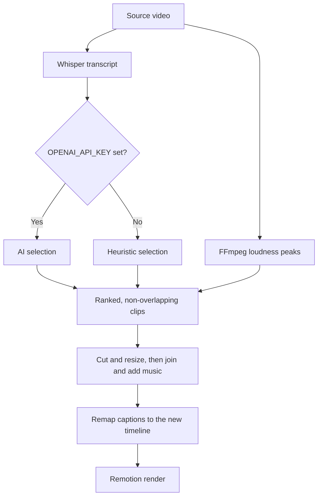

[](https://github.com/dannyhoang249-hub/Gamming-Video-editing/actions/workflows/ci.yml)

# Shorts Factory

Turn long gaming streams, podcasts, interviews and webinars into captioned, branded highlight videos.

Output is `1920×1080` (16:9) by default, or `1080×1920` (9:16) for Shorts, TikTok and Reels.

> **Status: alpha.** The pipeline runs end to end, but the API and config may change.

## Features

- Local transcription with Whisper, with word-level timestamps
- Highlight selection by an OpenAI model, or by a local heuristic without an API key
- Detection of sudden loud moments (shouts, explosions), even when nobody is speaking
- Keeps the source frame rate, up to 60 fps
- Cutting, joining, background music and aspect-ratio conversion with FFmpeg
- Captions of up to five words at a time, highlighting the spoken word
- Brand name, logo, accent color and progress bar, rendered with Remotion

## Quick start

You need Python 3.11+, Node.js 20+ and FFmpeg (including `ffprobe`).

```bash
# FFmpeg: `brew install ffmpeg` (macOS), `sudo apt install ffmpeg` (Ubuntu/Debian),
# or `choco install ffmpeg` (Windows)

python3 -m venv .venv
source .venv/bin/activate          # Windows: .venv\Scripts\activate
pip install -e '.[dev]'
npm install --prefix remotion

shorts media/gameplay.mp4 --output out --render
```

The finished video is `out/short.mp4`. The first run downloads the Whisper model.

Install with `-e`: rendering uses the `remotion/` folder of this checkout.

## Usage

```bash
shorts [input] [options]
```

| Flag | Description |
|---|---|
| `--config FILE` | YAML or JSON config file |
| `--output DIR` | Output directory (default: `out`) |
| `--clips N` | Number of highlights, 1 to 20 (default: 3) |
| `--model NAME` | Whisper model (default: `base`) |
| `--transcript FILE` | Use an existing transcript and skip Whisper |
| `--render` | Render `short.mp4`; without it the run stops after the render manifest |

Flags override values from the config file. `python3 -m shorts_factory.cli` works the same as `shorts`.

### AI selection

```bash
export OPENAI_API_KEY="your-api-key"     # PowerShell: $env:OPENAI_API_KEY="your-api-key"
```

With a key set, the transcript text and timestamps are sent to OpenAI. Without one, no transcript leaves your machine.

## Configuration

```bash
cp config.example.yml config.yml
shorts media/gameplay.mp4 --config config.yml --render
```

Unknown options are rejected, and `min_clip_seconds` cannot exceed `max_clip_seconds`.

| Option | Default | Description |
|---|---|---|
| `input` | required | Source video; can be given on the command line instead |
| `output_dir` | `out` | Directory for generated files |
| `model` | `base` | Whisper model: `tiny`, `base`, `small`, `medium`, `large` |
| `language` | `null` | Spoken language; `null` detects it |
| `clip_count` | `3` | Maximum number of highlights |
| `min_clip_seconds` | `12` | Minimum clip length |
| `max_clip_seconds` | `55` | Maximum clip length |
| `padding_seconds` | `1.5` | Time added around a selected sentence |
| `aspect_ratio` | `"16:9"` | `"16:9"` or `"9:16"` |
| `portrait_mode` | `crop` | For 9:16: `crop` the center, or `blur` to show the whole frame over a blurred copy |
| `music_path` | `null` | Background music, looped; becomes the soundtrack if the video has no audio |
| `ai_model` | `gpt-4o-mini` | Model used for AI selection |
| `brand.name` | `Your Brand` | Channel name |
| `brand.accent` | `#7C3AED` | Highlighted word and progress bar color |
| `brand.text_color` | `#FFFFFF` | Caption and watermark color |
| `brand.font_family` | `Arial` | Font installed on the rendering machine |
| `brand.logo_path` | `null` | Local file or `http(s)` URL |
| `brand.watermark` | `true` | Show the brand name |

## How it works



**Transcript.** Saved to `<output_dir>/transcript.json` and reused for the same source video until that file changes. Delete it after changing `model` or `language`. A file passed with `--transcript` is never rewritten.

**AI selection.** Long transcripts are sent in several requests, and one failed request does not discard the others. Each returned clip is validated, moved to nearby sentence boundaries and kept within the length limits. If AI selection yields nothing usable, the heuristic takes over.

**Heuristic selection.** Scores sentences by hook words (English and Vietnamese), questions and exclamations, and speech density. A short sentence is joined with the next ones only across pauses of up to 5 seconds.

**Audio peaks.** Two seconds at least 1.8 times louder than the median of the previous 16 seconds become a clip candidate of `min_clip_seconds`, mostly lead-up. The first 16 seconds never produce a peak. The `reason` field in `render-manifest.json` shows why each clip was picked.

## Output files

```text
out/
├── transcript.json              # not created when you pass --transcript
├── clips/clip-01.mp4 ...        # selected highlights
├── clips/concat.txt             # FFmpeg join list
├── public/
│   ├── vertical-source.mp4      # joined clips with music (landscape too, despite the name)
│   └── logo.*                   # copy of a local logo
├── render-manifest.json         # input for Remotion
└── short.mp4                    # final video, with --render
```

## Development

```text
shorts_factory/   cli, pipeline, transcriber, selector, ffmpeg, models
remotion/src/     video composition: captions and branding
tests/            unit tests and an end-to-end test
```

```bash
python3 -m pytest -q                                   # unit tests
E2E=1 python3 -m pytest -q tests/test_e2e.py           # real FFmpeg and Remotion
pip install ruff
ruff check --isolated --select E,F,I --line-length 120 .
npx --prefix remotion tsc --noEmit -p remotion/tsconfig.json
npm test --prefix remotion                             # caption tests, Node.js 22.18+
npm run start --prefix remotion                        # Remotion Studio
```

CI runs these checks on pushes to `main`, on pull requests and weekly. Dependabot opens weekly dependency updates.

## Limitations

- Highlights that are only visual, with no speech or loud audio, are not detected.
- Loud music or alerts in the source can be mistaken for highlights.
- Transcripts without word timings show the whole sentence as one caption.
- Larger Whisper models need more memory and time; a GPU helps.
- Video is encoded twice (when cutting and when rendering), which costs some quality.

## Credits

The peak-detection formula is adapted from [AutoClip](https://github.com/zhouxiaoka/autoclip) (MIT). See [NOTICE](NOTICE).
